<picture>
  <source media="(prefers-color-scheme: dark)" srcset="https://raw.githubusercontent.com/standard-librarian/standard-librarian/github-breakout/images/breakout-dark.svg" />
  <source media="(prefers-color-scheme: light)" srcset="https://raw.githubusercontent.com/standard-librarian/standard-librarian/github-breakout/images/breakout-light.svg" />
  
</picture>

# Medhat Mohammed

Independent Backend & AI Systems Engineer focused on **Go microservices**, **production AI agents & custom MCP servers**, **developer platforms & payments**, and **cloud cost reduction**.

- **Status:** Available for freelance sprints, remote contract roles & technical consulting ([mdht.me/hire](https://mdht.me/hire) · `mdht.muhd@gmail.com`)
- **Previously:** Backend Engineer @ 4Sale International (Go, PostgreSQL, Kafka/RabbitMQ, Centrifugo, Qdrant, MCP, AWS, K8s) · Software Engineer @ Opream (Java/Spring Boot microservices, Keycloak)
- **Open source:** [`sftpgo-manager`](https://github.com/standard-librarian/sftpgo-manager) · [`shapeshifter`](https://github.com/standard-librarian/shapeshifter) · [`rabbitmq-super-stream`](https://github.com/standard-librarian/rabbitmq-super-stream) · [`context-engineer`](https://github.com/standard-librarian/context-engineer)

## Featured production work

- **AI Listing Agent:** Deterministic 10-state conversational ad builder in Go + OpenAI JSON extraction + Centrifugo WebSockets/SSE + Whisper STT/TTS + Arabic catalog normalization
- **o16g (Outcome Engineering Platform):** Recursive-CTE knowledge graph + Qdrant semantic search + hand-rolled 48-tool OAuth 2.0 PKCE MCP server adopted across 8 IDE platforms
- **Developer Platform & Payments:** API keys, bulk listing APIs, HMAC-signed webhooks over RabbitMQ Super Streams, KNet Cashier + Kafka Saga orchestrator
- **SFTPGo Manager:** Self-hosted multi-tenant SFTP replacing AWS Transfer Family ($0.30/GB eliminated)

## Toolbox

- **Go:** Echo, Gin, Clean/Hexagonal Architecture, Godog BDD + Testcontainers
- **AI / Agents:** Custom MCP Servers (JSON-RPC 2.0, OAuth 2.0 PKCE), OpenAI Structured Outputs, Qdrant/pgvector, Whisper STT/TTS, Arabic NLP
- **Data & Messaging:** PostgreSQL, MySQL, Redis, Kafka, RabbitMQ Super Streams, Centrifugo
- **Infra & Enterprise:** Docker, Kubernetes, AWS (EKS, S3, SQS, DynamoDB), Java Spring Boot, Keycloak SSO/RBAC

## Hire / Contact

- Consulting & Services: https://mdht.me/hire
- Email: `mdht.muhd@gmail.com`
- LinkedIn: https://www.linkedin.com/in/mdht-mohd/
- Blog: https://mdht.me
